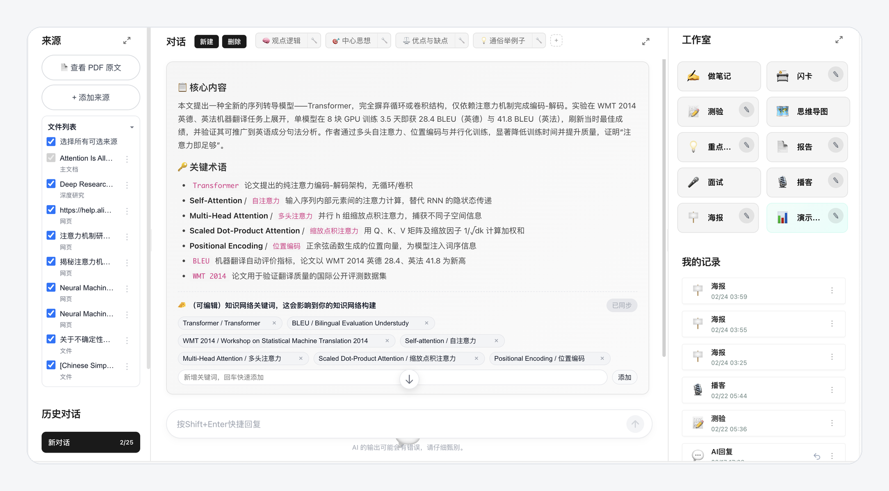
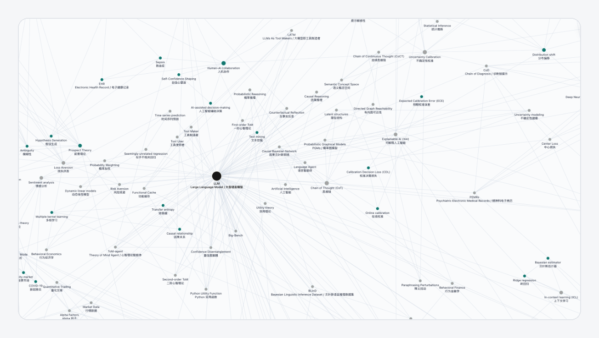
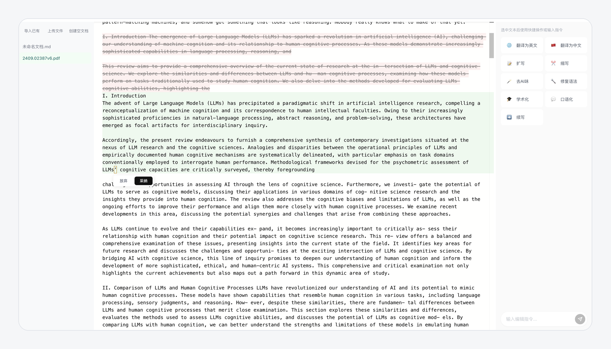
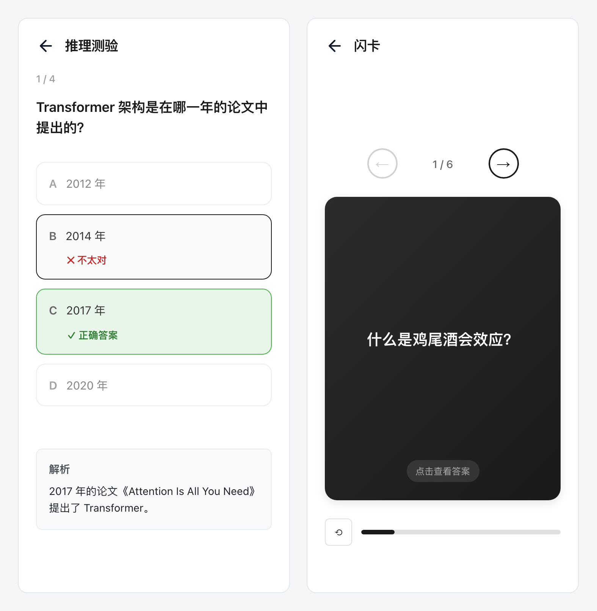
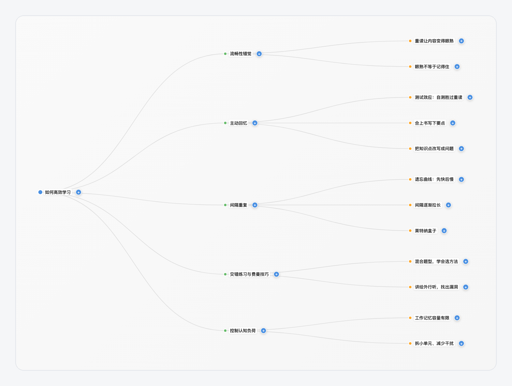

# UniNotebook

[简体中文](README.md) · **English**

UniNotebook turns papers, textbooks and web pages into material you can question and review. It runs on your own computer with your own API keys.

Claude Opus 4.8 wrote most of the project, from the backend and frontend to the tests. The product idea comes from Google NotebookLM.



## What it does

- **Document Q&A.** Upload a PDF or Word file, or paste a link or plain text, and ask about it. Answers cite their sources, and one conversation can draw on several sources at once.
- **Study tools.** Mind maps, flashcards, quizzes, key points, long-form reports and a mock interview based on the document. Everything you generate stays under 我的记录 (My records).
- **Knowledge network.** Terms from all your documents become one graph, linked when they appear together. It can point out clusters that have little to do with each other, and suggest an idea that connects two distant concepts.
- **Writing studio.** Select a passage and have it rewritten, expanded, shortened, translated or made more academic, then accept or discard each change.
- **Style imitation.** Paste a reference passage and your own text, and get your text back in the reference's style.
- **Slides, posters and podcasts** from a paper. These need extra packages and keys (see below).

The interface is in Chinese, except for the Settings page, which also has an English version. On first launch the workspace already holds three sample documents (in Chinese) with their summaries, mind maps, flashcards and quizzes, so you can look around before adding a key.

## Quick start

You need Python 3.10+ and Node.js 18+.

```bash
git clone https://github.com/yyveggie/uninotebook-oss.git
cd uninotebook-oss
python -m venv .venv
source .venv/bin/activate          # Windows: .venv\Scripts\activate
pip install -r requirements.txt
python run.py
```

Your browser opens <http://127.0.0.1:8000>. There is no sign-up and no login. The first run builds the frontend automatically.

Then click the avatar at the top right and open **设置** (Settings):

| Setting | Used for | |
|---|---|---|
| Chat model | Qwen, Kimi, DeepSeek or any OpenAI-compatible endpoint, including Ollama and LM Studio. One is enough. | Required |
| Embedding model | Searching your uploaded documents | Required to upload |
| Image generation | Slides and posters | Optional |
| DashScope speech and web research | Podcasts and web research | Optional |

You can test the connection for each model. The same page shows which features work right now and what each one is still missing.

## Screenshots

**Knowledge network.** Terms from all your documents in one graph.



**Writing studio.** Select a passage, let the AI revise it, and keep or drop each change.



**Quiz and flashcards**



**Mind map**



**Academic poster.** Needs an image-generation key and an optional package.


## Optional packages

The core install stays small. Add the rest when you need it:

```bash
pip install -e ".[parsing]"    # tables, formulas and complex layouts; also needs poppler
pip install -e ".[ppt]"        # paper to slides
pip install -e ".[poster]"     # academic posters
pip install -e ".[podcast]"    # podcasts; also needs ffmpeg
pip install -e ".[research]"   # web research
pip install -e ".[pymupdf]"    # faster PDF parsing
```

PDFs are parsed with pypdf (BSD) by default. PyMuPDF is licensed under AGPL-3.0. That is fine for personal use, but running this project as a closed-source network service may require a commercial license, so PyMuPDF is left out of the defaults.

## Data and security

- Documents, conversations and the vector store live in `~/.uninotebook/`. Use `--data-dir` to put them elsewhere, and copy the whole folder to back up.
- API keys are kept in `credentials.json` in that folder, readable only by your user account.
- There is no telemetry. Nothing leaves your computer except what you send to your model provider.
- The local version has no login, so it listens on 127.0.0.1 only. If you start it with `--host 0.0.0.0`, anyone on your network can read your documents and use your keys.

Port, upload size and worker counts are documented in `backend/.env.example`. The values in effect are listed under 运行环境 (Runtime) on the Settings page.

## Stack

FastAPI, SQLAlchemy on SQLite and an embedded ChromaDB on the backend, with a LangGraph ReAct agent answering questions. React and Vite on the frontend, with D3 drawing the knowledge network. No Redis, PostgreSQL or other services to run.

## Development

```bash
pip install -e ".[dev]"
python -m pytest backend/tests -q
```

Tests run against a temporary data folder and simulated models, so they never touch your keys.

## License

[MIT](LICENSE)
