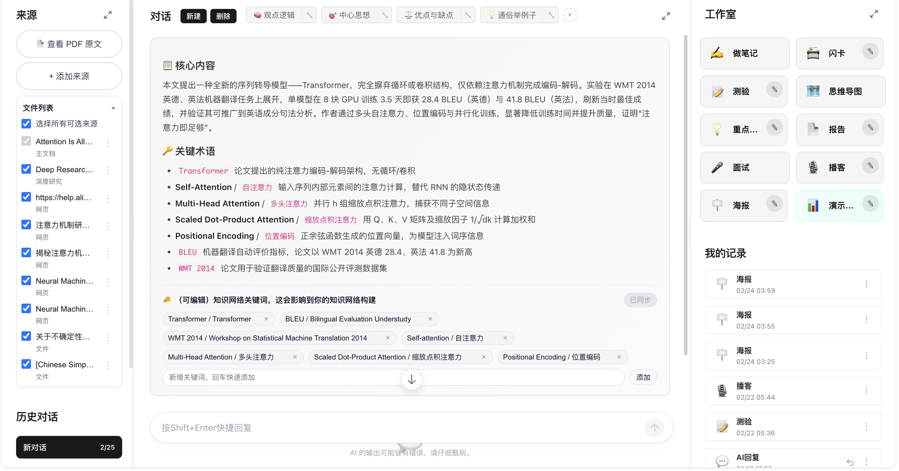
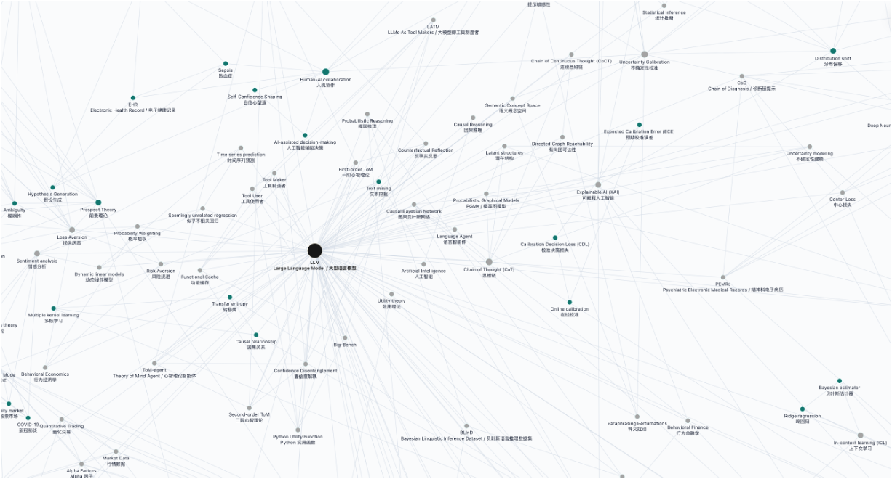
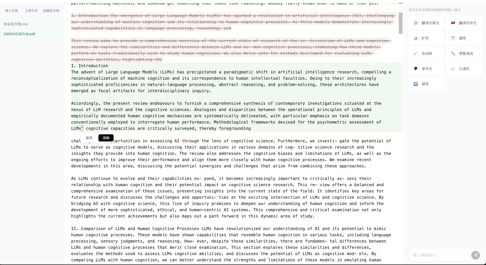
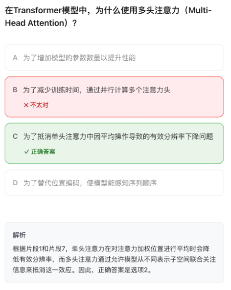
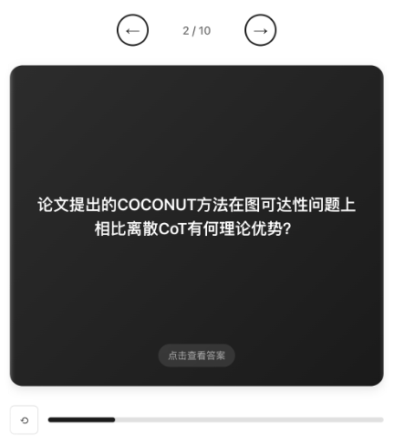
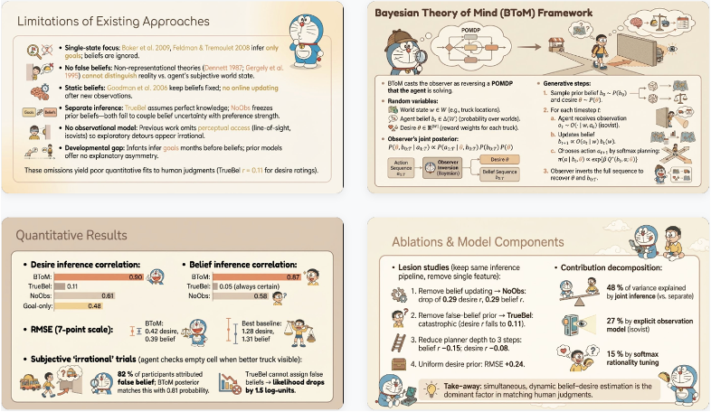

# UniNotebook

**简体中文** · [English](README.en.md)

把论文、教材和网页变成可以对话、可以复习的学习材料。运行在你自己的电脑上，用你自己的 API Key。

这个项目从后端、前端到测试，主要由 Claude Opus 4.8 完成。产品思路来自 Google NotebookLM。



## 能做什么

- **文档问答**：上传 PDF、Word，或者粘贴网页链接、文本，围绕内容提问。回答标注出处，一个对话里可以同时引用多份来源。
- **学习工具**：思维导图、闪卡、测验、重点提炼、深度报告，以及基于文档的模拟面试。生成结果都留在「我的记录」里。
- **知识网络**：从全部文档中抽取术语，按共同出现的关系连成一张图。「知识间隙」找出彼此缺少联系的知识群，「灵感生成」把相距很远的概念连成一个新想法。
- **创作空间**：选中一段文字，让 AI 改写、扩写、缩写、翻译或改成学术腔，逐段决定采纳还是放弃。
- **文本仿写**：给一段范文，把你的文字改成同样的风格。
- **论文转 PPT、学术海报、播客**：需要额外的依赖和 Key，见下文。

第一次打开时，工作台里已经放好三篇示例文档，摘要、思维导图、闪卡和测验都已生成。不填 Key 也能先看一遍。

## 快速开始

需要 Python 3.10+ 和 Node.js 18+。

```bash
git clone https://github.com/yyveggie/uninotebook-oss.git
cd uninotebook-oss
python -m venv .venv
source .venv/bin/activate          # Windows：.venv\Scripts\activate
pip install -r requirements.txt    # 国内网络可加 -i https://pypi.tuna.tsinghua.edu.cn/simple
python run.py
```

浏览器会自动打开 <http://127.0.0.1:8000>。不需要注册或登录，第一次运行时会自动构建前端。

然后点右上角的头像，打开**设置**：

| 配置项 | 用途 | |
|---|---|---|
| 对话模型 | 通义千问、Kimi、DeepSeek 或任意 OpenAI 兼容端点（包括 Ollama、LM Studio），选一个即可 | 必需 |
| 向量模型 | 检索上传的文档 | 上传文档时必需 |
| 图像生成 | 论文转 PPT、学术海报 | 可选 |
| 百炼语音与联网研究 | 播客、联网研究 | 可选 |

每个模型都可以测试连接。设置页同时列出每项功能当前能否使用、还缺什么，支持中文和 English。

## 截图

| 知识网络 | 创作空间 |
|---|---|
|  |  |
| **测验** | **闪卡** |
|  |  |
| **论文转 PPT** | **学术海报** |
|  |  |

## 可选依赖

核心安装不含重型依赖，用到时再装：

```bash
pip install -e ".[parsing]"    # 表格、公式等复杂版面解析，另需 poppler
pip install -e ".[ppt]"        # 论文转 PPT
pip install -e ".[poster]"     # 学术海报
pip install -e ".[podcast]"    # 播客，另需 ffmpeg
pip install -e ".[research]"   # 联网研究
pip install -e ".[pymupdf]"    # 更快的 PDF 解析
```

PDF 默认用 pypdf（BSD 许可）解析。PyMuPDF 采用 AGPL-3.0 许可，个人使用没有问题；如果要把本项目用于不开源的网络服务，可能需要另购商业授权，所以它不在默认依赖里。

## 数据与安全

- 文档、对话和向量库都存放在 `~/.uninotebook/`，可以用 `--data-dir` 换位置。备份时复制整个文件夹即可。
- API Key 保存在该目录下的 `credentials.json`，只有当前系统用户可读。
- 项目不含遥测。除了你主动发给模型服务商的内容，没有数据会离开这台电脑。
- 本地版没有登录保护，默认只监听 127.0.0.1。用 `--host 0.0.0.0` 开放到局域网后，同一网络里的任何人都能看到你的文档、使用你的 Key。

端口、上传大小、并发数等配置见 `backend/.env.example`，当前生效的值在设置页的「运行环境」里。

## 技术栈

后端是 FastAPI、SQLAlchemy（SQLite）和嵌入式 ChromaDB，问答由 LangGraph 的 ReAct Agent 驱动。前端是 React 和 Vite，知识网络用 D3 绘制。不需要 Redis、PostgreSQL 或其他外部服务。

## 开发

```bash
pip install -e ".[dev]"
python -m pytest backend/tests -q
```

测试使用临时数据目录和模拟模型，不会用到你的 Key。

## 许可证

[MIT](LICENSE)
